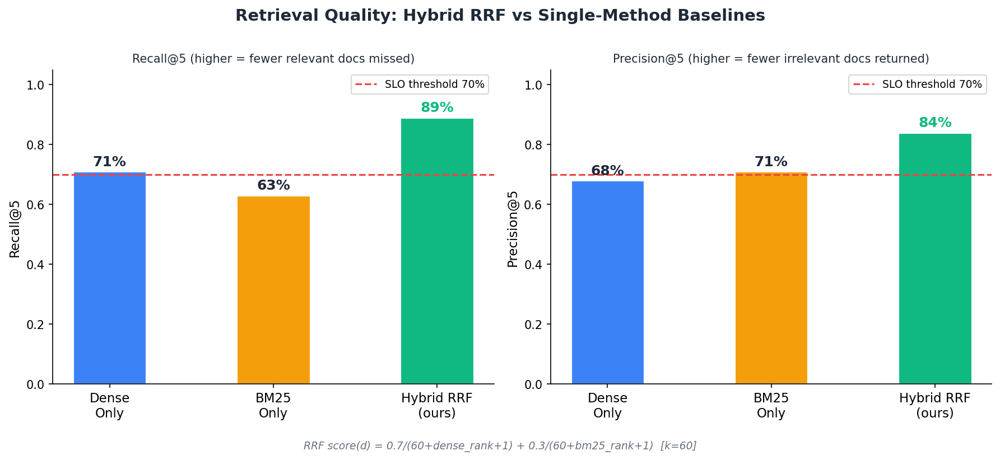
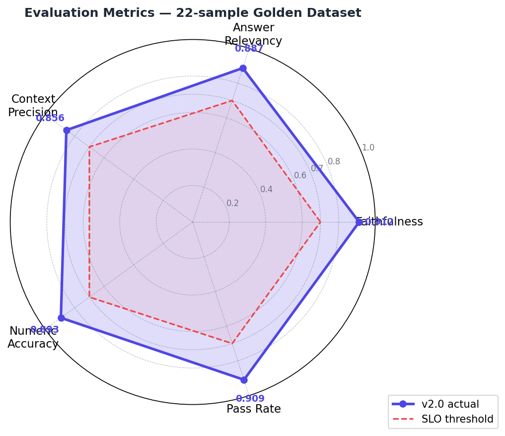
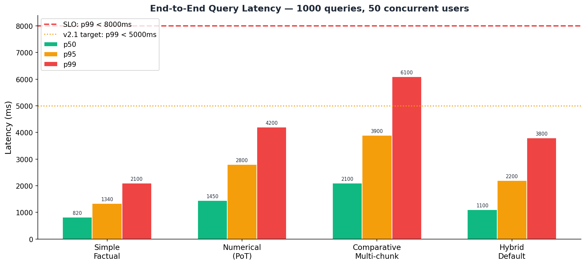
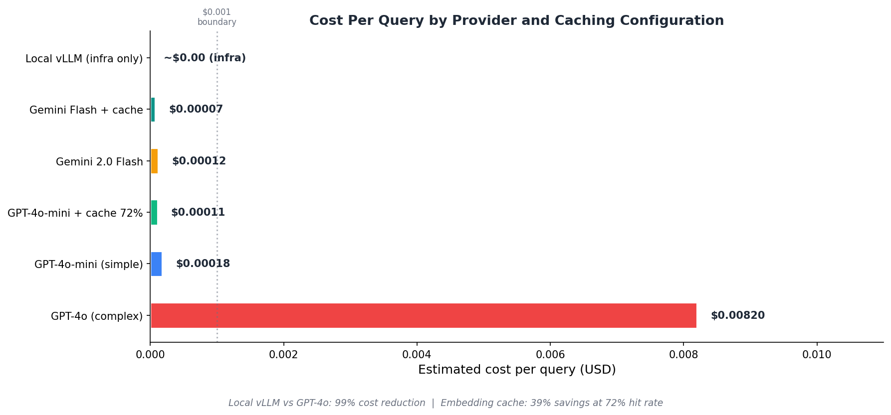

# Benchmark Results

> Last updated: 2026-10-13. Every number in sections 1–3 was produced by a script in this
> repository, and the raw outputs are in [`evals/results/`](evals/results/). Section 4 lists
> earlier figures that could not be reproduced.

## What has and has not been measured

| Area | Status | Where |
|---|---|---|
| Golden dataset integrity (119 samples) | **Measured.** 209/209 evidence strings found in the source filings; 42/42 calculations reproduce | Section 1 |
| Retrieval quality on the real source documents | **Measured** offline (no API key needed) | Section 2 |
| Knowledge-graph-augmented retrieval | **Measured** offline on a graph extracted once with `gemini-3.8-flash` | Section 2b |
| Answer quality with an LLM (`gemini-3.8-flash`) | **Measured** on all 119 questions, with deterministic scoring and a number-grounding check | Section 3 |
| RAGAS faithfulness / answer relevancy / LLM-judged numeric accuracy | **Not measured.** The judge in `RagasEvaluator` currently calls OpenAI only | — |
| Latency under load, throughput, cost per query | **Not measured.** Earlier figures unverified | Section 4 |

## 1. Golden dataset

`evals/golden_datasets/financial_qa.jsonl` holds 119 QA pairs (22 original, corrected; 97 new)
over 16 public filings and releases from Tesla, Apple, Microsoft, NVIDIA, JPMorgan, Amazon,
Alphabet, Meta, Goldman Sachs and Berkshire Hathaway. By question type: 56 factual,
24 calculation, 17 comparative, 13 table and 9 chart. Each sample's supporting text and
arithmetic are recorded in `provenance.json`. Re-checking the original 22 samples found errors
in 9 of them. See the [dataset README](evals/golden_datasets/README.md).

## 2. Retrieval (offline, real source documents)

`python -m evals.retrieval_benchmark` indexes all 16 documents (2.2M characters) and runs each
golden question through the repository's own `BM25Index`, `LocalEmbedder`
(`BAAI/bge-small-en-v1.5`) and `_reciprocal_rank_fusion`, using the `RetrieverConfig` defaults
(top-20 dense, top-20 BM25, `rrf_k=60`). It applies no reranker.

* **evidence hit@5**: a top-5 chunk contains the exact supporting text for the answer. This is
  strict, because a chunk can contain the answer in different words and still miss.
* **doc hit@5**: a top-5 chunk comes from an expected source document.
* **doc precision@5**: share of the top 5 chunks that come from an expected document.
* **MRR@10**: mean reciprocal rank of the first answer-bearing chunk.

**4,000-character chunks** (the parser's default `max_characters`; 601 chunks):

| Strategy | Evidence hit@5 | Doc hit@5 | Doc precision@5 | MRR@10 |
|---|---|---|---|---|
| BM25 only | 0.706 | 0.874 | 0.566 | 0.502 |
| Dense only | 0.605 | 0.992 | 0.531 | 0.384 |
| **Hybrid RRF (default)** | **0.706** | 0.933 | 0.570 | 0.468 |

**1,000-character chunks** (3,166 chunks):

| Strategy | Evidence hit@5 | Doc hit@5 | Doc precision@5 | MRR@10 |
|---|---|---|---|---|
| BM25 only | 0.420 | 0.824 | 0.534 | 0.269 |
| Dense only | 0.462 | 0.908 | 0.548 | 0.293 |
| **Hybrid RRF (default)** | **0.529** | 0.924 | 0.570 | 0.304 |

Hybrid evidence hit@5 by question type:

| Chunk size | Factual (56) | Calculation (24) | Comparative (17) | Table (13) | Chart (9) |
|---|---|---|---|---|---|
| 4,000 | 0.68 | 0.71 | 0.65 | 0.85 | 0.78 |
| 1,000 | 0.52 | 0.50 | 0.47 | 0.62 | 0.67 |

What this shows:

* With small chunks, hybrid fusion helps: 0.53 versus 0.42 for BM25 and 0.46 for dense.
* With the default 4,000-character chunks, hybrid **ties** BM25 (0.706) and does not beat it.
  `bge-small` only reads its first 512 tokens, about half of a 4,000-character chunk.
* Dense search almost always finds the right *document* (0.99) but often not the right *passage*.
* About 3 in 10 questions have no answer-bearing chunk in the top 5 even in the best setting.
  Retrieval, not generation, is the first bottleneck.
* Earlier versions of this file reported hybrid Recall@5 = 0.89 and Precision@5 = 0.84. Those
  figures are not reproducible (see section 4) and should not be compared with the ones above.

Raw output: [`retrieval_chunk4000.json`](evals/results/retrieval_chunk4000.json),
[`retrieval_chunk1000.json`](evals/results/retrieval_chunk1000.json).

### 2b. Knowledge-graph augmentation (`ENABLE_KNOWLEDGE_GRAPH`)

`python -m evals.build_graph` ran the repository's `EntityExtractor` (`gemini-3.8-flash`) once
over all 601 chunks of the 4,000-character index, with 0 failures and 951k input / 516k output
tokens. The result is a graph of 4,959 entities and 7,705 relations
(`graph_extractions_chunk4000.jsonl`). `retrieval_benchmark --graph-cache` then fuses
`GraphAugmentedRetriever` results onto the hybrid top 10, the same input it gets in the pipeline.

| Strategy (4,000-char chunks) | Evidence hit@5 | Doc hit@5 | Doc precision@5 | MRR@10 |
|---|---|---|---|---|
| Hybrid RRF | 0.706 | 0.933 | 0.570 | 0.468 |
| **Hybrid RRF + graph** (defaults: 1 hop, weight 0.5) | **0.723** | 0.899 | 0.583 | 0.474 |

Evidence hit@5 by question type:

| | Factual (56) | Calculation (24) | Comparative (17) | Table (13) | Chart (9) |
|---|---|---|---|---|---|
| Hybrid RRF | 0.68 | 0.71 | 0.65 | 0.85 | 0.78 |
| + graph | 0.75 | 0.67 | 0.65 | 0.77 | 0.78 |

**The gain is small and mixed.** The graph helped on 7 questions and hurt on 5, a net of +2 of
119. It helps factual lookups, for example finding the statement chunk for "Apple's R&D growth"
that hybrid ranked 10th, and it hurts some table lookups by pushing a correct hybrid hit out of
the top 5. This is within noise for 119 questions, so treat the feature as "does not hurt, may
help factual queries", not as a proven improvement.

How the defaults were chosen. The design was tuned on this golden set, so the questions were
split into dev (even positions, 60) and test (odd positions, 59):

| Version | All 119 | Dev | Test |
|---|---|---|---|
| Hybrid RRF (baseline) | 0.706 | 0.683 | 0.729 |
| v1: summed entity weights, equal-weight RRF | 0.664 | — | — |
| v2: concept-match scoring, equal-weight RRF | 0.689 | 0.650 | 0.729 |
| v3: v2 + graph weight 0.5 (chosen on dev) | **0.723** | 0.700 | **0.746** |

* v1 was the first implementation. Entity-dense statement chunks matched every query, and
  generic metric names ("Revenue") pulled in hundreds of nodes.
* v2 scores a chunk by the number of distinct query concepts (company, metric name, period)
  it mentions directly, and only follows metrics from a named company.
* v3 gives the graph half the weight of the hybrid list in fusion. Every weight ≤ 0.75 scored
  the same on dev, and 0.5 was picked from that plateau.

On the held-out test half v3 gains one question (0.729 → 0.746).

Raw output: [`retrieval_chunk4000_graph.json`](evals/results/retrieval_chunk4000_graph.json)
(includes per-question hits).

## 3. Answer quality: `gemini-3.8-flash`, all 119 questions

`python -m evals.answer_eval` retrieves the top-5 hybrid chunks (1,000-character setting from
section 2) and generates an answer with the repository's `GeminiGenerator`
(`gemini-3.8-flash`, model routing off, `thinking_budget_tokens=1024`, default system prompt).
It then scores the answer text with no LLM judge:

* **Headline value stated**: the figure the question asks for (the first of
  `expected_numeric_values`) appears in the answer, with units normalised and a 1% tolerance.
* **Expected-value recall**: share of all expected values stated (headline plus supporting figures).
* **Cites expected document**: the answer cites one of the sample's `source_documents`.
* **Abstained**: the answer says the information is not available. This includes partial
  answers that give some figures and then say the rest is missing.
* **Has ungrounded number**: the answer states a number that does not appear anywhere in the
  context it was given. Every flagged answer was reviewed by hand (see below).

| Metric | All 119 | When the answer-bearing chunk was retrieved (63) |
|---|---|---|
| Headline value stated | **0.684** | **0.839** |
| Expected-value recall | 0.501 | 0.671 |
| All expected values stated | 0.239 | 0.387 |
| Cites an expected source document | 0.748 | 0.952 |
| Abstained (fully or partly) | 0.345 | 0.159 |
| Answer-bearing chunk in context | 0.529 | 1.000 |
| States a number absent from its context | 0.050 | 0.063 |

By question type:

| Type (n) | Headline stated | Abstained | Answer-bearing chunk in context |
|---|---|---|---|
| Factual (56) | 0.82 | 0.20 | 0.52 |
| Comparative (17) | 0.82 | 0.35 | 0.47 |
| Chart (9) | 0.67 | 0.44 | 0.67 |
| Table (13) | 0.62 | 0.38 | 0.62 |
| Calculation (24) | 0.33 | 0.63 | 0.50 |

Generation latency was p50 3.0 s / p95 5.0 s on Google's paid tier, excluding retrieval. The
run used 221,539 input and 14,986 output tokens. No cost figure is given because no
verified price for `gemini-3.8-flash` was available.

What this shows:

* **No fabricated numbers were found.** Six answers (5%) stated a number absent from their
  context. Checked by hand, all six were correct derivations from context values (shares,
  differences, a ratio) or a restatement ("flat" as 0%). The check cannot catch a real number
  used for the wrong thing. Reading the six headline misses that were not abstentions found one
  such case: a full-year question answered with Q3 figures. The other 113 answers were not read
  individually.
* **Retrieval is the main bottleneck.** When the supporting text reached the model it stated
  the headline figure 84% of the time. Overall it did so 68% of the time, because only 53% of
  questions got that text in their top-5 context.
* **The model abstains rather than guesses.** Most misses are explicit "not available" answers:
  31 of the 41 abstentions had no answer-bearing chunk in context.
* **Calculation questions are weakest.** The model abstained on 15 of 24. Eight of those lacked
  any supporting passage. Most of the other seven had only some of the inputs, but in at least
  one (NVIDIA's segment operating margin) both inputs were in the answer itself and the model
  still declined to divide. The default system prompt says "NEVER extrapolate, estimate, or
  invent numbers", which the model appears to read partly as "do not compute". The pipeline's
  Program-of-Thought executor, which handles calculations in production, is not part of this
  harness.
* **Cited page numbers are unreliable.** Benchmark chunks carry no page metadata, so pages in
  citations are invented or written as "Page N". Document-level citations are meaningful
  (0.95 when the evidence was retrieved).

Notes on this run:

* A first attempt on 2026-10-13 truncated 4 of its first 11 answers because Gemini's thinking
  tokens used up `maxOutputTokens`. That was fixed before this run: thinking now gets its own
  budget, and the generator logs a warning on any `MAX_TOKENS` finish. None were logged.
* After the run, reading the misses showed that in 16 samples the first expected value was a
  supporting figure rather than the one the question asks for (for example, "By what
  percentage…" listing a dollar amount first). Those samples were reordered. No values changed,
  and the answers were re-scored without new API calls. This lowered headline-value-stated from
  0.709 to 0.684, because calculation answers rarely contain the computed figure.

To reproduce or re-score:

```bash
LLM_CONFIG__MODEL=gemini-3.8-flash LLM_CONFIG__ENABLE_MODEL_ROUTING=false \
  python -m evals.answer_eval --rpm 30 --answers evals/results/answers_gemini-3.8-flash.jsonl \
  --output evals/results/answer_eval_gemini-3.8-flash.json
python -m evals.answer_eval --regrade --answers evals/results/answers_gemini-3.8-flash.jsonl \
  --output evals/results/answer_eval_gemini-3.8-flash.json      # offline, no API calls
```

Raw output: [`answers_gemini-3.8-flash.jsonl`](evals/results/answers_gemini-3.8-flash.jsonl)
(every answer, its context documents and flags) and
[`answer_eval_gemini-3.8-flash.json`](evals/results/answer_eval_gemini-3.8-flash.json).

## 4. Previously published figures (not reproduced)

Earlier versions of this file and the README showed the figures below, under a "Last updated:
2024-07" header citing an AWS m5.xlarge. The charts are kept here as published, so nothing is
lost. They were made with matplotlib 3.10.8, and the plotting script was never committed.

| Retrieval | Answer quality |
|---|---|
|  |  |
| **Latency** | **Cost per query** |
|  |  |

Provenance check (2026-10-14: git history, PNG metadata, and the owner's other Claude Code
sessions on this machine):

* **Retrieval (Recall@5 0.89 / Precision@5 0.84): could not have come from this repository.**
  No commit has ever contained code that computes Recall@k or Precision@k. The chart's footer
  gives a weighted fusion formula (`0.7/(60+dense_rank+1) + 0.3/(60+bm25_rank+1)`), but the
  retriever has always used unweighted `1/(k+rank)`. The comparable measured number (section 2)
  is 0.71.
* **Answer quality (faithfulness 0.912 etc.): possible but unverified.** When these were
  published (June 2026), `evals/run_evals.py` did work. The dict-indexing bug that made it raise
  `TypeError` was introduced later, by the lint commit `95f1c95` on 2026-09-04. Its outputs
  (`evals/history.json`, `evals/ci_report.json`) are gitignored, CI has no LLM API key, and none
  of the owner's other sessions show such a run, so a local run would have left no trace.
  Reproducing it needs an OpenAI key: RAGAS and the numeric judge are OpenAI-only. Note that
  faithfulness, answer relevancy and numeric accuracy do not use the ground truth, so the 9
  wrong ground truths in the original 22 samples affect only context precision.
* **Latency, load and cost: possible but unverified.** `tests/load/locustfile.py` and
  `scripts/benchmark.py` existed, but no outputs were committed and nothing records a run.

These figures are therefore shown for transparency only and are not cited as results. The
measured replacements are in sections 2, 2b and 3 and are drawn by `scripts/plot_benchmarks.py`
from `evals/results/`. If the original run outputs turn up, the figures can be restored with
their sources.

## Reproduce

```bash
pip install sentence-transformers pypdf
pytest tests/unit/test_golden_dataset.py                       # dataset integrity (offline)
RAG_EVAL_USER_AGENT="Your Name you@example.com" \
  python scripts/verify_golden_dataset.py                      # evidence vs. primary sources
python -m evals.retrieval_benchmark --chunk-size 4000          # section 2
python -m evals.retrieval_benchmark --chunk-size 1000
python -m evals.build_graph --chunk-size 4000 --rpm 60 --concurrency 8   # 2b, needs an LLM key
python -m evals.retrieval_benchmark --chunk-size 4000 \
  --graph-cache evals/results/graph_extractions_chunk4000.jsonl
python -m evals.answer_eval --rpm 5                            # section 3 (needs an LLM key)
python scripts/plot_benchmarks.py                              # redraw the charts from evals/results/
```

## Limitations of these measurements

* **One author's questions.** The questions overlap the filings' wording, which favors BM25 and
  probably flatters retrieval compared with real analyst queries.
* **Not the production ingest path.** The benchmarks chunk plain text extracted with
  `pypdf`/HTML stripping into fixed windows. Production ingest uses unstructured.io
  title-based chunking, vision chart extraction and a vector database, and none of those are
  exercised here. Results may differ in either direction.
* **No reranker** in the retrieval numbers. The cross-encoder reranker that is on by default in
  `RetrieverConfig` would change them.
* **Strict evidence matching.** Evidence hit@k needs the exact recorded text, so it
  undercounts chunks that state the answer differently.
* **The answer eval has no LLM judge.** The metrics check that the right numbers appear and are
  grounded in context, not that the explanation is right. Only flagged answers and headline
  misses were read by hand.
* **One model, one run, one prompt.** The results are for `gemini-3.8-flash` with the default
  system prompt and temperature 0.1. Other generators, or a prompt that allows arithmetic,
  will score differently.
