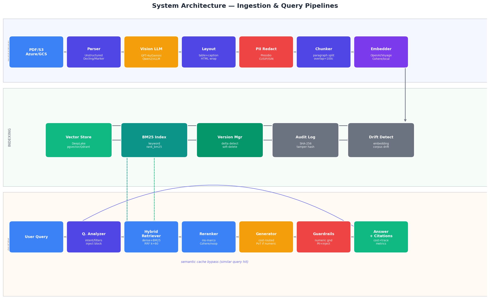
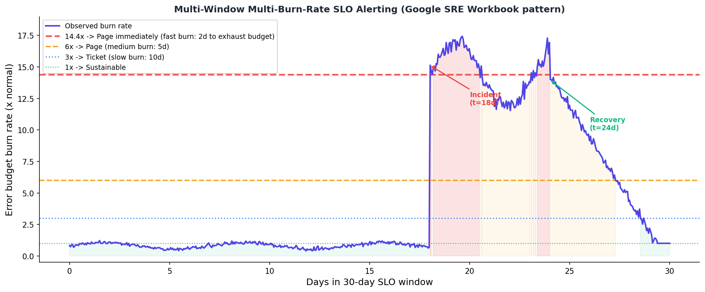
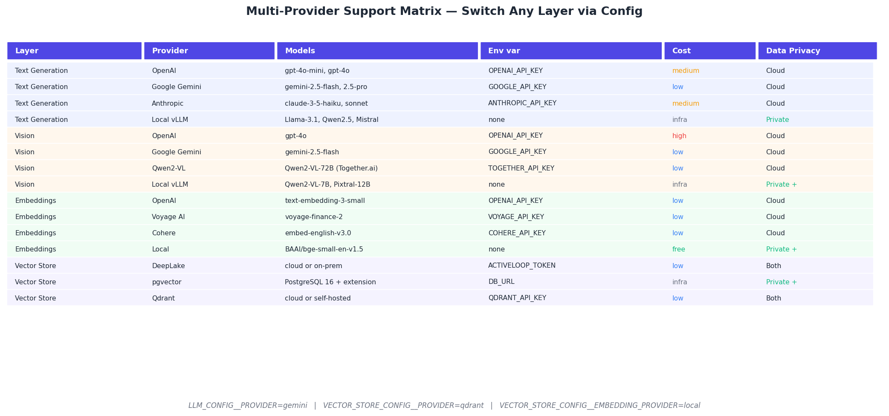

# RAG Financial Multimodal

**Production-grade multimodal RAG for financial document intelligence.**

---

## System Architecture



*Complete ingestion and query pipeline. Every component implements an ABC — switch any layer via a single config value.*

---

## Why This System Stands Out

| Problem | This System's Solution |
|---|---|
| Charts and graphs are invisible to text-only RAG | Vision LLM extraction — GPT-4o / Gemini 2.5 Flash / Qwen2-VL / local vLLM with fallback chain |
| Exact financial figures miss semantic search | Hybrid RRF: dense embeddings + BM25 keyword search fused with Reciprocal Rank Fusion |
| LLMs fabricate numbers | Numeric grounding guardrail verifies every stated number against retrieved source text |
| One API vendor fails = full outage | Provider fallback chains at every model-facing layer |
| Data must not leave the network | Fully local/open-source configuration: vLLM + BAAI/bge + pgvector, zero external API calls |

---

## Quickstart

```bash
git clone https://github.com/Mattral/RAG-Multimodal-Financial-Doc-Analysis-and-Recall
cd RAG-Multimodal-Financial-Doc-Analysis-and-Recall
cp .env.example .env
docker compose up -d
curl -X POST http://localhost:8000/api/v1/ingest -F "file=@your_10k.pdf"
curl -X POST http://localhost:8000/api/v1/query \
  -H "Content-Type: application/json" \
  -d '{"query": "What was gross margin in Q3 2023?"}'
```

See [Quickstart → Docker](quickstart/docker.md) for the full walkthrough.

---

## Evaluation

* **Golden dataset:** 119 QA pairs over 16 public filings from 10 companies, every figure
  traced to its source passage. See the
  [dataset README](https://github.com/Mattral/RAG-Multimodal-Financial-Doc-Analysis-and-Recall/blob/main/evals/golden_datasets/README.md).
* **Retrieval, measured offline on the real filings:** hybrid RRF puts an answer-bearing chunk in
  the top 5 for 71% of questions at the default 4,000-character chunks, the same as BM25 alone.
  With 1,000-character chunks it reaches 53% versus 42% for BM25.
* **Answer quality, latency and cost:** not yet measured on a reproducible run. Earlier figures
  were withdrawn. See
  [BENCHMARK_RESULTS.md](https://github.com/Mattral/RAG-Multimodal-Financial-Doc-Analysis-and-Recall/blob/main/BENCHMARK_RESULTS.md).

---

## SLO Alerting



*Multi-window multi-burn-rate alerting (Google SRE Workbook). Four alert tiers with PagerDuty/OpsGenie routing.*

---

## Provider Support



*Every model-facing layer is independently configurable. Switch with one env var — no code changes.*

---

## Key Numbers

| Metric | Value |
|---|---|
| Tests collected | 814 |
| Golden eval samples | 119 |
| Architecture Decision Records | 8 |
| Prometheus metrics | 15 |
| Grafana dashboards | 2 |
| K8s manifests | 15 |
| Vector store backends | DeepLake, pgvector, Qdrant (all real implementations) |
| Providers supported | 4 LLMs · 4 vision · 4 embedders · 3 vector stores · 3 cloud connectors |
